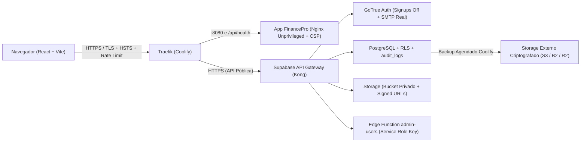

# Plano de Segurança e Deploy — FinancePro (VPS + Coolify + Supabase)

## Overview

Este documento define o plano executivo de remediação de segurança e preparação para produção do **FinancePro — Gestor de Contas a Pagar** (`Cpag`), corrigindo todas as vulnerabilidades críticas, altas e médias identificadas na auditoria antes da publicação na nuvem.

- **Tipo de Projeto:** `WEB` (React 19 + TypeScript + Vite + Tailwind CSS + Supabase + Docker/Nginx)
- **Decisões Confirmadas:**
  - **Hospedagem e Nuvem:** VPS própria gerenciada via **Coolify** com **Supabase** self-hosted.
  - **Modelo de Acesso:** **Empresa única** (todos os usuários autenticados compartilham a mesma base financeira, com diferenciação de permissões entre `ADMIN` e `USER`).
  - **Perfil `USER` (Menor Privilégio):** Configurado como **somente leitura** em `accounts`, `system_settings` e visualização de anexos via *Signed URLs* (podendo atualizar apenas o próprio `preferred_theme`), alinhado ao painel de permissões de `UserManagement.tsx` e bloqueado tanto na UI quanto por RLS/triggers no PostgreSQL.
  - **Banco de Dados e Autenticação:** **Início limpo do zero** (sem migração de dados legados), adotando autenticação oficial via **Supabase Auth** com login por e-mail.

---

## Arquitetura Alvo



---

## Critérios de Sucesso

- [x] Políticas RLS configuradas bloqueando `anon` em `public.profiles`, `public.accounts`, `public.system_settings`, `public.audit_logs` e no bucket privado `attachments` (`database/02_rls_and_storage.sql`). *(Validar em runtime após aplicar os scripts na VPS.)*
- [x] Zero senhas ou hashes expostos ao navegador; zero sessão manual em `localStorage` (`financepro_session`); zero credenciais padrão hardcoded (`admin`/`Admin@123`, `admin123`).
- [x] Redefinição de senha exclusivamente via fluxo oficial do Supabase Auth por e-mail (`resetPasswordForEmail` + evento `PASSWORD_RECOVERY` + `updateUser`).
- [x] Gestão de usuários (`list`, `create`, `update`, `delete`) implementada server-side via Edge Function (`supabase/functions/admin-users/index.ts`) validando JWT e `role = 'ADMIN'`.
- [x] Anexos financeiros em bucket privado com download apenas por *Signed URLs* temporárias (`createSignedUrl`) e validação de MIME type, extensão, caminho e protocolo HTTP/HTTPS.
- [x] Backup e importação validados por schema estrito (`zod`), restritos a `ADMIN`, sem exportação de `users` e sem escrita genérica em `localStorage`.
- [x] `npm audit --omit=dev` com 0 vulnerabilidades (`jspdf` atualizado para `4.2.1`, `jspdf-autotable` `5.0.9`, `bcryptjs` e `@vercel/analytics` removidos, `zod` `4.6.7` adicionado).
- [x] `Dockerfile` determinístico (`npm ci` com `package-lock.json`), rodando sem privilégios de `root` (`nginxinc/nginx-unprivileged:1.27-alpine` na porta `8080`), headers HTTP de segurança ativos em `nginx.conf` e `/api/health` configurado para `200 OK`. *(Docker CLI não instalado localmente; build de imagem será validado no Coolify/VPS.)*
- [x] `npx tsc --noEmit`, `npm run build` e `python .agent/skills/vulnerability-scanner/scripts/security_scan.py .` aprovados sem vulnerabilidades no código do projeto.

---

## Stack e Decisões Técnicas

| Camada | Tecnologia / Decisão | Racional |
| :--- | :--- | :--- |
| **Frontend** | React 19, TypeScript, Vite `6.4.6`, Tailwind CSS 3, Recharts, Lucide React | Mantém a base existente com build atualizado e sem CVEs de dev server expostos |
| **Validação e PDF** | `zod` (`4.6.7`), `jspdf` (`4.2.1`), `jspdf-autotable` (`5.0.9`) | Schema estrito em backups/importações e eliminação dos CVEs críticos do `jspdf@2.5.1` |
| **Remoções** | `bcryptjs`, `@types/bcryptjs`, `@vercel/analytics`, `vercel.json` | Autenticação migra para o servidor (Supabase Auth) e deploy passa a ser VPS/Coolify |
| **Backend & Banco** | Supabase Auth, PostgreSQL com RLS estrito e triggers de auditoria, Supabase Storage privado | Garante controle de acesso no banco (`auth.uid()`, `is_admin()`) e trilha de auditoria |
| **Admin API** | Supabase Edge Function (`supabase/functions/admin-users/index.ts`) | Isola a `SUPABASE_SERVICE_ROLE_KEY` no servidor para criação/gestão de usuários |
| **Infraestrutura** | Docker multi-stage (`node:20-alpine` → `nginxinc/nginx-unprivileged:1.27-alpine`), Nginx `:8080`, Coolify + Traefik | Container não-root, headers de segurança (`CSP`, `X-Frame-Options`, `nosniff`), HTTPS/HSTS e backups agendados |

---

## Estrutura de Arquivos Implementada

### Arquivos Criados
- `database/01_schema_secure.sql` — Schema unificado (`profiles` vinculada a `auth.users`, `accounts` com `uuid` + `created_by`/`updated_by`, `system_settings`, `audit_logs`).
- `database/02_rls_and_storage.sql` — Função `public.is_admin()`, bloqueio para `anon`, políticas RLS estritas em todas as tabelas e políticas para o bucket privado `attachments`.
- `database/03_audit_triggers.sql` — Triggers de proteção contra auto-promoção de `role` em `profiles`, criação/sincronização de perfil via `auth.users` e trilha `audit_logs`.
- `supabase/functions/admin-users/index.ts` — Edge Function autenticada como `ADMIN` (com allowlist CORS via `ALLOWED_ORIGIN`) para listar, criar, atualizar e excluir usuários via `auth.admin`.
- `.env.example` — Modelo seguro de variáveis de build (`VITE_SUPABASE_URL` e `VITE_SUPABASE_ANON_KEY`) sem segredos.

### Arquivos Modificados
- `types.ts`, `tsconfig.json`, `services/supabase.ts`, `services/auth.ts`, `services/userService.ts`, `services/storage.ts`, `services/fileService.ts`, `services/settingsService.ts`, `services/backupService.ts`, `services/report.ts`
- `App.tsx`, `components/Login.tsx`, `components/UserManagement.tsx`, `components/AccountForm.tsx`, `components/AccountList.tsx`, `components/ImportModal.tsx`, `components/AppSettingsView.tsx`
- `package.json`, `package-lock.json`, `vite.config.ts`, `Dockerfile`, `.dockerignore`, `nginx.conf`, `metadata.json`

### Arquivos Removidos
- `vercel.json`
- Scripts SQL legados inseguros: `database/supabase_schema.sql`, `database/supabase_schema_full.sql`, `database/CPAG_DATABASE_RECOVERY.sql`, `database/RESET_ADMIN_PASS.sql`, `database/supabase_full_dump.sql`

---

## Detalhamento das Tarefas (Task Breakdown)

### Fase 1 — Autenticação Real, Perfis, RLS e Edge Function (P0 · Crítica)

- [x] **T1.1 — Schema seguro, RLS estrito, Storage privado e Auditoria no PostgreSQL**
  - Criados `database/01_schema_secure.sql`, `database/02_rls_and_storage.sql` e `database/03_audit_triggers.sql`.
  - Removidos os 5 scripts SQL legados inseguros.

- [x] **T1.2 — Edge Function administrativa para gestão de usuários**
  - Criada `supabase/functions/admin-users/index.ts` com validação de JWT, verificação de `role = 'ADMIN'` em `public.profiles`, allowlist CORS via `ALLOWED_ORIGIN`, bloqueio de auto-exclusão/auto-rebaixamento e proteção contra remoção do último administrador.
  - Adicionado `"exclude": ["supabase", "node_modules", "dist"]` em `tsconfig.json`.

- [x] **T1.3 — Refatoração da camada de autenticação, sessão e usuários no front-end**
  - `services/auth.ts` migrado para `supabase.auth` (`signInWithPassword`, `signOut`, `getSession`, `onAuthStateChange` sem deadlock de lock, `resetPasswordForEmail`, `updateUser`).
  - `services/userService.ts` migrado para invocação da Edge Function `admin-users` e atualização de `preferred_theme` em `profiles`.
  - Removido campo `password` de `User` em `types.ts`.

- [x] **T1.4 — Atualização da UI de Login, Usuários e Controle de Acesso**
  - `components/Login.tsx` adaptado para login por e-mail, solicitação de link de recuperação e redefinição pós-`PASSWORD_RECOVERY`.
  - `components/UserManagement.tsx` adaptado para Edge Function, bloqueio de auto-exclusão/auto-rebaixamento por `currentUserId` e exibição de erros.
  - `App.tsx` e `components/AccountList.tsx` atualizados com separação estrita `ADMIN` vs `USER` (leitura).

### Fase 2 — Storage Privado, Backup Seguro e Integridade (P1 · Alta)

- [x] **T2.1 — Anexos privados com Signed URLs e validação de protocolo**
  - `services/fileService.ts` usando `crypto.randomUUID()`, whitelist de MIME/extensão (`jpg`, `jpeg`, `png`, `pdf`), bucket privado `attachments`, `createSignedUrl` temporária (300s) e validação `isSafeHttpUrl`.
  - `components/AccountForm.tsx` e `components/AccountList.tsx` abrindo anexos apenas por *Signed URL* validada; remoção fail-closed em `AccountForm.tsx`.

- [x] **T2.2 — Blindagem de Backup/Restore e tratamento de erros (Fail-Closed)**
  - `services/backupService.ts` restrito a `ADMIN`, com validação `zod`, limites de tamanho (10MB ZIP / 20MB JSON / 50 mil contas), sem exportação de `users` e sem escrita em `localStorage`.
  - `services/storage.ts` e `services/settingsService.ts` sem cache de configurações em `localStorage` e lançando erros reais para feedback na UI (`appError` em `App.tsx` e alertas em `AppSettingsView.tsx`).
  - `handleImport` em `App.tsx` usando `storageService.addAccounts(imported)` com `crypto.randomUUID()` em `App.tsx` e `ImportModal.tsx`.

### Fase 3 — Limpeza e Atualização de Dependências (P1 · Alta)

- [x] **T3.1 — Remoção de pacotes legados e atualização de dependências vulneráveis**
  - Desinstalados `bcryptjs`, `@types/bcryptjs` e `@vercel/analytics` (e removido `<Analytics />` de `App.tsx` e `vercel.json`).
  - Atualizados `jspdf@^4.2.1`, `jspdf-autotable@^5.0.9`, `@supabase/supabase-js@^2.119.2`, `vite@^6.4.6` e instalado `zod@^4.6.7`.
  - `services/report.ts` atualizado para `autoTable(doc, ...)` e `doc.getNumberOfPages()`.
  - `vite.config.ts` restringido para `host: 'localhost'` no dev local; `metadata.json` sem permissão `"camera"`.

### Fase 4 — Hardening Docker, Nginx e Checklist Coolify/VPS (P2 · Média)

- [x] **T4.1 — Hardening do Dockerfile, `.dockerignore` e `nginx.conf`**
  - `.dockerignore` mantendo `package-lock.json` e excluindo arquivos sensíveis/auxiliares (`.env`, `.env.*`, `database`, `supabase`, `*.md`).
  - `Dockerfile` multi-stage com `ARG VITE_SUPABASE_URL` / `ARG VITE_SUPABASE_ANON_KEY`, `npm ci`, imagem final `nginxinc/nginx-unprivileged:1.27-alpine`, porta `8080` e `HEALTHCHECK`.
  - `nginx.conf` escutando em `8080`, `server_tokens off;`, CSP, `X-Frame-Options: DENY`, `X-Content-Type-Options: nosniff`, `Referrer-Policy`, `Permissions-Policy`, bloqueio a dotfiles e `/api/health`.

- [x] **T4.2 — Configuração de ambiente e roteiro de deploy na VPS/Coolify**
  - Criado `.env.example` e documentado o roteiro operacional completo abaixo.

---

## Guia Operacional de Deploy — VPS + Coolify + Supabase

Siga exatamente esta sequência na VPS antes de liberar o acesso aos usuários:

### 1. Aplicar Scripts SQL no Supabase (Banco Limpo)
No **SQL Editor** do Supabase Studio, execute os três arquivos na ordem:
1. `database/01_schema_secure.sql`
2. `database/02_rls_and_storage.sql`
3. `database/03_audit_triggers.sql`

### 2. Configurar Autenticação (GoTrue) e SMTP no Supabase
No `.env` / variáveis do stack Supabase no Coolify:
- Desabilitar cadastro público:
  - `GOTRUE_DISABLE_SIGNUP=true`
- Definir URL da aplicação e redirecionamento permitido para recuperação de senha:
  - `SITE_URL=https://app.seudominio.com`
  - `ADDITIONAL_REDIRECT_URLS=https://app.seudominio.com`
- Configurar SMTP real para entrega de links de *"Esqueci minha senha"*:
  - `GOTRUE_SMTP_HOST`, `GOTRUE_SMTP_PORT`, `GOTRUE_SMTP_USER`, `GOTRUE_SMTP_PASS`, `GOTRUE_SMTP_ADMIN_EMAIL`, `GOTRUE_SMTP_SENDER_NAME=FinancePro`

### 3. Deploy da Edge Function `admin-users`
Defina as variáveis de ambiente / secrets do runtime Edge Functions do Supabase:
- `SUPABASE_URL` (URL interna ou pública do Supabase)
- `SUPABASE_ANON_KEY`
- `SUPABASE_SERVICE_ROLE_KEY` *(nunca colocar no frontend)*
- `ALLOWED_ORIGIN=https://app.seudominio.com` *(separe múltiplos domínios por vírgula, se houver staging)*

Publique a função `supabase/functions/admin-users/index.ts` conforme o fluxo do seu serviço Edge Runtime no Supabase self-hosted.

### 4. Criar o Primeiro Administrador (Sem Senha Hardcoded)
1. No **Supabase Studio → Authentication → Users → Add user**, crie o primeiro usuário com e-mail real e uma senha forte gerada no momento.
2. Promova esse usuário a `ADMIN` executando no **SQL Editor** (substituindo pelo e-mail criado):
```sql
UPDATE auth.users
SET raw_app_meta_data = COALESCE(raw_app_meta_data, '{}'::jsonb) || '{"role": "ADMIN"}'::jsonb
WHERE email = 'admin@seudominio.com';

UPDATE public.profiles
SET role = 'ADMIN', login = 'admin', full_name = 'Administrador Master'
WHERE email = 'admin@seudominio.com';
```

### 5. Proteger Infraestrutura da VPS, Traefik e Studio
- **Firewall UFW na VPS:** liberar apenas `80/tcp`, `443/tcp` e `SSH` por chave pública (desabilitar autenticação SSH por senha). Manter a porta `5432` (PostgreSQL) fechada para a internet externa.
- **Supabase Studio:** manter atrás de autenticação forte (Basic Auth / SSO do Traefik ou acesso restrito via VPN/Tailscale), nunca exposto sem proteção.
- **Coolify (Serviço Web FinancePro):**
  - **Port Exposes:** `8080`
  - **Health Check Path:** `/api/health`
  - **Build Variables (obrigatório marcar como Build Variable):** `VITE_SUPABASE_URL` e `VITE_SUPABASE_ANON_KEY` (usando os valores de `.env.example` sem expor a Service Role Key).
  - **Opcional recomendado em `nginx.conf`:** após definir o domínio do Supabase, substituir `https:` / `wss:` em `connect-src` e `img-src` pelo domínio exato do seu Supabase.
- **Traefik (Coolify Proxy):** habilitar HTTPS automático (Let's Encrypt), redirecionamento HTTP→HTTPS, header **HSTS** (`Strict-Transport-Security`) e **Rate Limiting** nas rotas públicas.
- **Backups Agendados (Coolify):** ativar *Scheduled Backups* do PostgreSQL do Supabase para storage externo criptografado (AWS S3, Backblaze B2 ou Cloudflare R2).

---

## Fase X — Verificação Final

### Comandos Executados Localmente (2026-11-20)
```powershell
npx tsc --noEmit                                                           # EXIT 0 (0 erros)
npm run build                                                              # EXIT 0 (dist/ gerado com Vite 6.4.6)
npm audit --omit=dev                                                       # EXIT 0 (0 vulnerabilidades)
python .agent/skills/vulnerability-scanner/scripts/security_scan.py . --output summary
```
- **Nota sobre `security_scan.py`:** Zero apontamentos no código da aplicação (`App.tsx`, `components/`, `services/`, `database/`, `supabase/`, `Dockerfile`, `nginx.conf`). Os únicos alertas reportados pelo script são assinaturas internas do próprio arquivo `.agent/skills/vulnerability-scanner/scripts/security_scan.py` e ausência de `yarn.lock`/`pnpm-lock.yaml` (projeto usa `package-lock.json`).
- **Nota sobre Docker:** O CLI `docker` não está instalado no ambiente Windows local; a construção da imagem será executada diretamente pelo pipeline Docker do Coolify na VPS.

### Testes Funcionais Pós-Deploy (Staging / VPS)
- [ ] Login por e-mail com sessão gerenciada pelo Supabase Auth (sem `financepro_session` manual).
- [ ] Tentativa de acesso anônimo às tabelas `profiles`, `accounts`, `system_settings` e `audit_logs` bloqueada por RLS.
- [ ] Fluxo *"Esqueci minha senha"* envia e-mail real via SMTP e redefine senha via token `PASSWORD_RECOVERY`.
- [ ] Usuário com perfil `USER` visualiza Dashboard, Movimentações, PDF e anexos (via *Signed URL*), sem acesso a criar/editar/excluir contas, Gestão de Usuários, Configurações ou Backup/Importação (na UI e via API/RLS).
- [ ] Upload e abertura de anexo em `accounts` funcionam apenas com *Signed URL* temporária do usuário autenticado.
- [ ] Exportação de PDF (`reportService`) gera relatório sem erros de console.
- [ ] Endpoint `/api/health` responde `200 OK` e cabeçalhos `CSP`, `HSTS`, `X-Frame-Options` e `X-Content-Type-Options` estão presentes na resposta HTTPS.

## Status de Conclusão
- [x] Lint & Typecheck (`npx tsc --noEmit`)
- [x] Security Audit (`npm audit --omit=dev` com 0 vulnerabilidades + código limpo no `security_scan.py`)
- [x] Build (`npm run build`)
- [ ] Runtime / Deploy Verification (pendente de execução dos scripts SQL, configuração de env/SMTP e deploy na VPS/Coolify)
